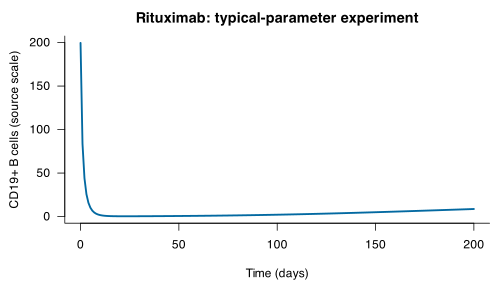

# Run and plot a model in Python

[Choose a model](../MODEL_CATALOG.md) · [Understand results](understand-results.md) · [Change an input](change-inputs.md)

Complete the [README setup](../README.md#setup), activate that environment,
and run the blocks below from the library checkout. Core simulation needs no
plotting packages.

Prefer a notebook? Open the [executable notebook](python-quickstart.ipynb) in Jupyter
after setup. It locates the library checkout automatically and saves CSV output
in the notebook’s working directory.

## Run the first experiment

```python
from qspquest_models import Library

library = Library('.')
print(len(library.list_models()))  # 72 identities
model = library.load('qspquest_serkland_2025_rituximab_ms_pkpd', version='0.3.0')
print(model.scenario_ids)
result = model.run('population-typical-1000mg-full-ode')
assert len(result['times']) == 201
model.write_csv(result, 'rituximab-python.csv')
print('Saved rituximab-python.csv and its .manifest.json with', len(result['times']), 'rows')
```

`result` contains `times`, event `sides`, named `outputs` and `states`, units,
archive checksum and engine identity. The CSV has 201 data rows from day 0 to day 200 with `time`, `side`,
`rituximab_concentration_mg_l`, `cd19_cells_mm3` as the primary readouts. The [model guide](../models/qspquest_serkland_2025_rituximab_ms_pkpd/0.3.0/MODEL_CARD.md) explains the available experiments.
[Output interpretation](understand-results.md) explains the source numerical scale and units.

## Plot CD19+ B cells (optional)

Install matplotlib into the same environment with `python -m pip install matplotlib`.
Then continue in the same Python session:

```python
import matplotlib.pyplot as plt

cd19_cells_mm3 = next(c for c in result['outputs'] if c['name'] == 'cd19_cells_mm3')
plt.plot(result['times'], cd19_cells_mm3['values'])
plt.xlabel('Time (' + result['time_unit'] + ')')
plt.ylabel('CD19+ B cells (source scale)')
plt.show()
```



This preview uses the retained version 0.1.0 result. Its numerical reference
applies to that archive and recorded execution; inspect the selected version’s
`evidence.json` before treating a new run as qualified.

The B-cell readout starts at 199.57 and ends near 8.70521 at day 200.
This curve describes a fixed typical parameter set, rather than population variability
or a recommended redosing time.

## Try a synthetic benchmark

```python
model = library.load('qspquest_diffdose_2026_idr_benchmark')
result = model.run('lower_exposure')
```

## Find your next model

Browse the [model catalog](../MODEL_CATALOG.md) for scientific descriptions and
experiment choices. In Python, you can filter the structured records:

```python
matches = [row for row in library.list_models()
           if 'rituximab' in row['name'].lower() and row['scenario_ids']]
for row in matches:
    print(row['name'], row['id'])
```

## Compare declared representations of a source

The rat AAV/mAb source family has full and reduced representations. After setup,
run this from the library checkout to inspect their identities without running a
simulation:

```bash
python - <<'FAMILY'
from qspquest_models import Library

library = Library('.')
family_id = 'liu-2026-aav-mab-targetx-rat-brain'
related = [row for row in library.list_models()
           if row.get('source_family', {}).get('family_id') == family_id]
assert len(related) == 2
canonical = related[0]['source_family']['canonical_model']
for row in related:
    assert row['source_family']['canonical_model'] == canonical
    print(row['model_fidelity'], row['id'], row['version'], len(row['scenario_ids']))
    print('archive:', row['omex_sha256'])
    print('units:', row['availability']['unit_status'])
print('canonical:', canonical['model_id'], canonical['version'])
FAMILY
```

Expect the full model at version `2.1.2` with 13 presets and the reduced model at
`0.1.0` with seven. Both point to the full model as the canonical representation.
The hashes identify the exact archives; the unit status remains
`source_scale_unqualified`. Read each linked model guide before selecting an
experiment. A full representation does not establish publication reproduction,
physical units or qualification for your engine and request.

An absent `source_family` means no relationship is declared. Do not infer one
from a shared word in a name. If catalog verification reports a stale family pin,
verify the package files; a newer version needs an explicitly reviewed family
record rather than silently inheriting a previous declaration.

Continue with [comparing experiments or changing a dose](change-inputs.md).
For exact version selection and archive inspection, use the [technical reference](model-format.md).

For reproducible edits, the [input-binding tutorial](input-bindings.md) selects an
exact version, inspects aliases and native units, retains the binding hash and
saves a research copy with its input provenance.

This example requires the matching QSPQuest engine with `[cell]` count-unit support. The selected model uses `mg/L` rituximab concentration and `[cell]/mm3` CD19-positive cell density; its dimensional and numerical qualification remain pending. An `unknown_unit` error means the engine build lacks count-unit support: install the matching engine rather than substituting unit `1`.
