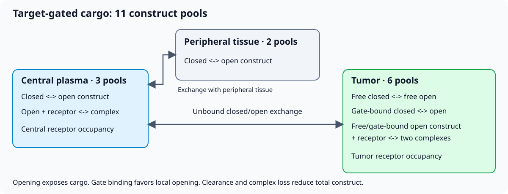
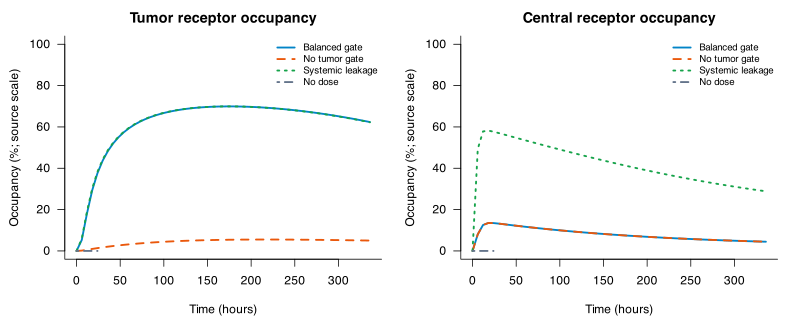

# QSP: how a local gate changes receptor occupancy

Explore a mechanistic question: can local gate-assisted opening increase tumor
cargo-receptor occupancy while retaining lower systemic occupancy?
This independently authored model uses synthetic parameters, 11 state pools and
existing named simulation presets. No dataset or download is required after
installing QSPQuest and cloning the library.

The tutorial uses version **2.0.0** of `qspquest_ubi_2026_target_gated_cargo_qsp`.
It demonstrates simulation and amount accounting, not efficacy, toxicity or
population fitting. Numerical values use the archive's source coordinates;
physical dimensions are not independently certified. See the
[model card](../models/qspquest_ubi_2026_target_gated_cargo_qsp/2.0.0/MODEL_CARD.md).

## Start

Complete the [library setup](../README.md#setup). The Python
simulation and checks need only the loader and QSPQuest CLI. Install the plot
and notebook tools into the same environment:

```sh
python -m pip install matplotlib jupyterlab
python -m jupyterlab tutorials/qsp-gated-cargo.ipynb
```

Run the notebook cells in order, or copy the Python blocks below into a script
and run it from the library root. Results go to `qsp-output/` under the library
root. The [R tutorial](qsp-gated-cargo.Rmd) runs the same presets and checks with
base R plotting; it also needs `jsonlite`, `rmarkdown` and Pandoc to render.

## Understand the mechanism



The diagram groups the pools; it does not show every reaction. Only unbound
closed/open constructs exchange between compartments. Opening exposes cargo;
closing masks it. A tumor gate binds construct and favors opening. Open cargo
can bind a central or tumor receptor, including a gate-retained tumor complex.
Clearance, internalization and gate-bound loss remove construct.

| Compartment | State pools |
| --- | --- |
| Central | closed, open, receptor-bound (3) |
| Peripheral | closed, open (2) |
| Tumor | closed, open, gate-bound closed, gate-bound open, receptor-bound open, gate/receptor-bound open (6) |

Background opening and closing contribute `k_open*C - k_close*O` to the open
pool and the opposite flux to the closed pool. Each exchange or binding flux
also removes construct from one pool and adds it to another. Summing all 11
pools cancels those internal transfers. Total construct declines through the
explicit loss processes after the single dose; it is not conserved in the body.

## Load the model

```python
from pathlib import Path
import json
from qspquest_models import Library

root = next(path for path in [Path.cwd(), *Path.cwd().parents]
            if (path / 'catalog.json').is_file())
model = Library(root).load('qspquest_ubi_2026_target_gated_cargo_qsp')
output = root / 'qsp-output'
output.mkdir(exist_ok=True)
```

## Run a controlled comparison

Each dosed preset gives the same single 30-unit IV bolus of closed construct at
0 h and samples every 6 h through 336 h (57 rows). The source names those dose
coordinates nmol. The zero-dose control covers 0–24 h (25 rows).

| Preset | Mechanism change from balanced gating |
| --- | --- |
| `balanced_gate_30nmol_iv` | Baseline synthetic gate and opening assumptions |
| `no_tumor_gate_30nmol_iv` | Tumor gate capacity: 0.15 → 0 |
| `leaky_systemic_gate_30nmol_iv` | Background opening rate: 0.004 → 0.04 |
| `no_dose_homeostasis` | No dose; all construct pools start at zero |

The other two named presets remain available for later exploration. These
comparisons change mechanisms as specified by the archive, rather than fitting
unknown parameters.

```python
scenarios = {
    'Balanced gate': 'balanced_gate_30nmol_iv',
    'No tumor gate': 'no_tumor_gate_30nmol_iv',
    'Systemic leakage': 'leaky_systemic_gate_30nmol_iv',
    'No dose': 'no_dose_homeostasis',
}
results = {label: model.run(scenario) for label, scenario in scenarios.items()}
for label, result in results.items():
    expected_rows = 25 if label == 'No dose' else 57
    assert len(result['times']) == expected_rows
    print(label, len(result['times']), 'rows', result['identity']['algorithm'])


def values(result, name):
    return next(column['values'] for column in result['outputs'] if column['name'] == name)
```

## Compare tumor and systemic occupancy



This preview uses the distributed results. The code below runs and plots your own results.

```python
import matplotlib.pyplot as plt

fig, axes = plt.subplots(1, 2, figsize=(11, 4), sharey=True)
colors = ['#0284c7', '#ea580c', '#16a34a', '#64748b']
styles = ['-', '--', ':', '-.']
for i, (label, result) in enumerate(results.items()):
    for axis, name in zip(axes, ['tumor_receptor_occupancy_percent',
                                 'central_receptor_occupancy_percent']):
        axis.plot(result['times'], values(result, name), label=label,
                  color=colors[i], linestyle=styles[i])
axes[0].set_title('Tumor receptor occupancy')
axes[1].set_title('Central receptor occupancy')
for axis in axes:
    axis.set_xlabel('Time (h)')
    axis.set_ylim(0, 100)
    axis.set_ylabel('Occupancy (%; source scale)')
    axis.legend()
fig.tight_layout()
fig.savefig(output / 'receptor-occupancy.png', dpi=150)
plt.show()

for label, result in results.items():
    i = result['times'].index(24.0)
    print(label,
          'tumor:', round(values(result, 'tumor_receptor_occupancy_percent')[i], 2),
          'central:', round(values(result, 'central_receptor_occupancy_percent')[i], 2))
```

At 24 h the balanced preset gives about **37.65% tumor / 13.48% central**
occupancy. Removing the tumor gate gives **1.37% / 13.48%**. Background leakage
gives **38.33% / 57.70%**; both zero-dose readouts remain zero.
Removing the gate reduces local occupancy; increasing background opening raises
systemic occupancy. These are consequences of this synthetic model and its fixed
parameters, not biological or clinical predictions. The two occupancy panels
are more interpretable than a ratio when the denominator is zero.

## Reconcile amounts and check controls

Sum the 11 construct pools and compare them to the archived total
readout at every sampled time. Check nonnegativity, occupancy bounds, the
initial dose and absence of unexpected amount increases. A small absolute
numerical allowance of `1e-8` is used in the archive's numeric coordinates.
This reconciliation checks mapping and sampled behavior; it does not reconstruct
a continuous clearance integral or prove the equations are biologically correct.

```python
checks = {}
for label, result in results.items():
    total = values(result, 'total_construct_nmol')
    pools = [column['values'] for column in result['states']]
    assert len(pools) == 11
    ledger_error = max(abs(sum(pool[i] for pool in pools) - total[i])
                       for i in range(len(total)))
    assert ledger_error <= 1e-8
    assert min(value for pool in pools for value in pool) >= -1e-8
    assert all(later <= earlier + 1e-8 for earlier, later in zip(total, total[1:]))
    for name in ['tumor_receptor_occupancy_percent', 'central_receptor_occupancy_percent']:
        assert all(-1e-8 <= value <= 100 + 1e-8 for value in values(result, name))
    expected_dose = 0.0 if label == 'No dose' else 30.0
    assert abs(total[0] - expected_dose) <= 1e-8
    if label == 'No dose':
        assert max(abs(value) for pool in pools for value in pool) <= 1e-8
    checks[label] = {'max_amount_reconciliation_error': ledger_error,
                     'initial_total': total[0], 'final_total': total[-1]}
print(json.dumps(checks, indent=2))
```

## Export the analysis

CSV files include outputs and all 11 state pools. JSON retains the archive pin,
solver identity, exact sampling and selected scenario. Reuse the same inputs to
reproduce the figures; changed inputs need new checks.

```python
for label, result in results.items():
    scenario = scenarios[label]
    model.write_csv(result, output / (scenario + '.csv'), include_states=True)
    (output / (scenario + '.json')).write_text(json.dumps(result, indent=2, allow_nan=False))
(output / 'checks.json').write_text(json.dumps(checks, indent=2, allow_nan=False))
print('Saved trajectories, checks and plot to', output)
```

[Change the dose](change-inputs.md) · [Choose another model](../MODEL_CATALOG.md) ·
[Archive inspection and reproducibility](model-format.md)
