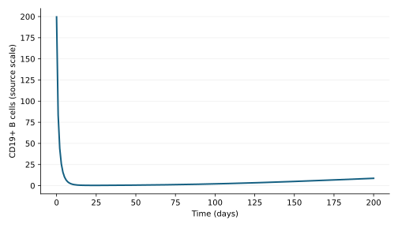

# Run and plot a model in R

[Choose a model](../MODEL_CATALOG.md) · [Understand results](understand-results.md) · [Change an input](change-inputs.md)

Complete the [README setup](../README.md#setup). R uses a local Python
bridge to the same standalone engine. Start R from the activated environment in
the library checkout, or set `QSPQUEST_PYTHON` to that environment's Python path.

Install the one R dependency if needed:

```r
install.packages('jsonlite')
```

## Run the first experiment

```r
source('tutorials/qspquest-models.R')
models <- qspquest_library(getwd())
length(models$models())  # 72 identities
model <- 'qspquest_serkland_2025_rituximab_ms_pkpd'
models$scenarios(model, version = '0.3.1')
result <- models$run(model, 'population-typical-1000mg-full-ode', csv = 'rituximab-r.csv', version = '0.3.1')
trajectory <- qspquest_data_frame(result)
stopifnot(nrow(trajectory) == 201L)
head(trajectory)
saved <- qspquest_read_table('rituximab-r.csv')
stopifnot(nrow(saved) == 201L)
```

The table contains `time`, event `side` and the primary readouts
`rituximab_concentration_mg_l` and `cd19_cells_mm3`. The [model guide](../models/qspquest_serkland_2025_rituximab_ms_pkpd/0.3.1/MODEL_CARD.md) explains the experiments;
[Understand results](understand-results.md) explains the units.
The optional `version` argument selects an exact model version. If that version
is not available, the run stops instead of falling back; omit it to use the
default. `models$inputs(model, scenario, version = '0.3.1')` accepts it too.

## Plot B-cell dynamics

```r
plot(trajectory$time, trajectory$cd19_cells_mm3, type = 'l',
     xlab = result$time_unit, ylab = 'CD19+ B cells (source scale)')
```



This preview shows the stored result from version 0.1.0; it is not a check of version 0.3.1.

The B-cell readout starts at 199.57 and ends near 8.70521 at day 200.
It uses one fixed parameter set, not a patient population.

## Try a synthetic benchmark

```r
model <- 'qspquest_diffdose_2026_idr_benchmark'
scenarios <- models$scenarios(model)
result <- models$run(model, 'lower_exposure')
trajectory <- qspquest_data_frame(result)
```

Use the [model catalog](../MODEL_CATALOG.md) to choose another model and read its
experiment descriptions. The bridge returns runnable experiments only.
The [input-change guide](change-inputs.md) includes supported Python, R and CLI examples for editing doses and initial states.

If Python cannot import the loader, select the environment where `pip install -e .`
ran: `Sys.setenv(QSPQUEST_PYTHON = '/absolute/path/to/.venv/bin/python')`.
If no engine is found, set `QSPQUEST_EXECUTABLE` to the CLI's absolute path.
Recreate `models` after changing these variables. See the
[executable R Markdown](r-quickstart.Rmd) for a complete run.

This example needs the matching QSPQuest engine, which supports the `[cell]` count unit. The model reports rituximab concentration in `mg/L` and CD19+ cell density in `[cell]/mm3`; these units have not yet been independently checked. An `unknown_unit` error means your engine lacks `[cell]` support: install the matching engine instead of changing the unit to `1`.
